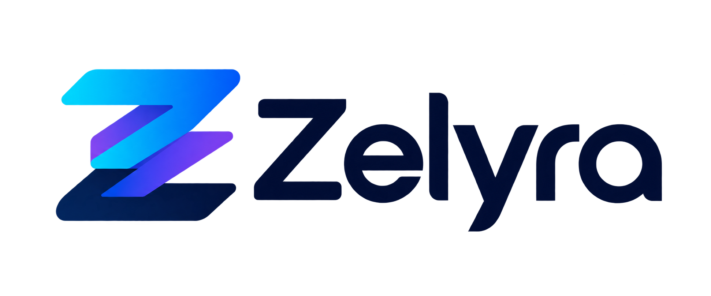

# Zelyra

**From database to application.** · **AI writes. Zelyra verifies.**

[Deutsch](README.de.md) · English

Zelyra is an independent, statically typed language and application platform
for database-backed business and web applications. It brings schema-aware SQL,
forms, CRUD, views, and application logic together while keeping ordinary code
and native SQL available.

> **Current stable compiler release: 0.9.3 · language compatibility line: 0.1 · experimental**
>
> Zelyra 0.9.3 remains experimental and is not approved for production use. “Prove correctness” is a
> design goal: the current verifier covers a bounded subset and does not prove
> arbitrary applications correct.

The stable [`v0.9.3` release](https://github.com/sf1976/zelyra/releases/tag/v0.9.3) remains experimental and is not production-approved. Independent human acceptance remains reserved for 1.0.0; this README is not acceptance evidence. See the [0.9.3 release notes](docs/release-notes/0.9.3.en.md), [database support matrix](docs/database-support.en.md), and [1.0.0 release plan](docs/release-plans/1.0.0.en.md).

## What changed in 0.9.3

Studio adds a bounded read-only database browser, compiler-checked source
column edits, and confirmed MariaDB database creation for an existing
connection. The CLI adds an initial read-only Laravel inventory. Native
Decimal, Date, Time, Duration, Bytes, Tuple, and Set values support the CSV and
labyrinth examples. The type matrix still lists partial and unavailable
concepts; this release does not claim complete type coverage. See the
[release notes](docs/release-notes/0.9.3.en.md), [type inventory](examples/type_system/README.md),
[Studio guide](docs/studio.en.md), and [Laravel Migrator guide](docs/laravel-migrator.en.md).

## What changed in 0.9.2

Studio added contextual command help, a searchable action finder, compiler
completion and diagnostics, cross-file navigation, a project map, and an
explicit bounded run action. The invoice tutorial gained a guided local start.
See the [0.9.2 release notes](docs/release-notes/0.9.2.en.md).

## What changed in 0.9.1

Studio now keeps its local session across tab reloads, removes the session token from the address bar, shows unsaved changes, saves with `Ctrl+S`, and displays compiler diagnostics in its Problems panel. Chromium browser checks cover these workflows with MariaDB and PostgreSQL. The invoice tutorial calculates net, 19% VAT, and gross totals; the browser can save its print view as PDF. `#` line comments and standalone `##` block delimiters are standard; legacy `//` comments remain compatible. The release is still experimental and has not received independent human acceptance. See the [release notes](docs/release-notes/0.9.1.en.md) and [Studio guide](docs/studio.en.md).

## What changed in 0.9.0

Zelyra 0.9.0 expands Studio's guided CRUD preview with affected files, tables, relationships, and routes; extends the invoice tutorial; and adds preview-first `zelyra text edit` plans for bounded regular-expression changes. It also expands the language compatibility corpus and includes an optional, local MariaDB TOTP MFA preview. MFA is not independently security-approved. MySQL and PostgreSQL support remains limited to the workflows in the published matrix; this release does not claim full SQL parity or production readiness. See the [release notes](docs/release-notes/0.9.0.en.md) and [Studio guide](docs/studio.en.md).

The [roadmap](docs/ROADMAP.md) tracks implementation status and limitations.
This README is a project overview, not a second handbook or changelog.

## Start here

### Try the language

From a source checkout:

~~~bash
git clone https://github.com/sf1976/zelyra.git
cd zelyra
./install.sh
zelyra run examples/fibonacci.zyl
~~~

Expected output: `55`. Published Linux and Windows x86_64 binaries can also be
installed without a Rust toolchain; see the [release downloads](https://github.com/sf1976/zelyra/releases)
and the installation guide.

For an interactive CLI example, run `zelyra run examples/console_input.zyl`.
It uses the explicit `Console` capability; the example's project grant is
enabled in the repository's `zelyra.toml`. See the [I/O chapter in the
handbook](docs/handbook/en/textbook-foundations.md#chapter-8-input-and-output) for new
projects.

### Start a MariaDB CRUD application

~~~bash
zelyra new machine-management --template mariadb-crud
cd machine-management
zelyra setup --all
~~~

The setup command reports the local application address. This path requires
Docker Engine and Compose to be installed and accessible; Zelyra does not
install or modify Docker. The [setup guide](docs/setup-web.md) explains the
console and browser setup flows, permissions, ports, and troubleshooting.

Generated `.env` files contain local credentials in plaintext. They are
excluded from Git and Docker build contexts; Zelyra sets newly created files to
owner-only permissions (`0600`) on Unix. On Windows, the file inherits the
directory's ACL, and existing `.env` files are not re-permissioned. Do not
commit or share the file. For production, use an appropriate secrets manager
and deployment-specific credentials; 0.9.3 is not production-approved.

The generated MariaDB project defaults to German and learn mode. Set
`ZELYRA_LANGUAGE=de|en` and `ZELYRA_LEVEL=learn|work` in its `.env` to change
the generated interface. See the environment reference for precedence and
other settings.

## Documentation

| If you want to… | Read |
| --- | --- |
| Learn Zelyra step by step | [Getting started](docs/getting-started.md) · [English handbook](docs/handbook/en/handbook.md) · [Deutsches Handbuch](docs/handbook/de/handbuch.md) |
| See what works in compiler 0.9.3 | [Implemented capabilities](docs/implemented.en.md) · [Deutsch](docs/implemented.de.md) |
| Check what the language specifies | [Language specification](docs/specification.md) · [Source authority and validation guide](docs/source-authority.md) |
| Configure a project or its environment | [Environment and configuration reference](docs/env.en.md) · [Deutsche Referenz](docs/env.md) |
| Understand database support | [Database support matrix](docs/database-support.en.md) · [German](docs/database-support.de.md) |
| Use the local editor or preview a safe regex edit | [Zelyra Studio](docs/web-editor.en.md) · [Text edit command](docs/text-edit.en.md) |
| Review current and planned work | [Roadmap](docs/ROADMAP.md) · [0.9.3 release plan](docs/release-plans/0.9.3.en.md) · [1.0.0 release plan](docs/release-plans/1.0.0.en.md) |
| Read the design direction | [Manifesto](docs/MANIFESTO.md) · [AI-native architecture](docs/architecture/ai-native-development.md) · [Readable regex text-edit design](docs/design/readable-regex-text-editing.en.md) |
| See exact release changes | [Changelog](CHANGELOG.md) · [GitHub releases](https://github.com/sf1976/zelyra/releases) |

The handbook contains tutorials and detailed language/runtime examples. The
formal specification and compiler tests define what is accepted today; the
roadmap distinguishes implemented, partial, planned, optional, and deferred
work. Zelyra syntax must not be inferred from Rust or another language.

## Product principles

- **Database-first, MariaDB-first:** schema, checked native SQL, forms, and
  generated business interfaces share typed information. SQLite is supported
  for tested workflows; PostgreSQL 16 has a bounded experimental direct-SQL
  runtime, not full parity or universal database portability.
- **Views are part of the language platform:** reusable layouts, components,
  slots, generated CRUD views, localization, and project-local style
  customization are evolving together. The roadmap documents remaining gaps.
- **AI-native, not AI-dependent:** compiler diagnostics, project context,
  impact analysis, and formatting provide machine-usable tools. No AI provider
  or cloud service is required; compiler checks and tests remain authoritative.
- **Digital sovereignty:** local execution and data control, no unsolicited
  telemetry, explicit security boundaries, and evidence-based claims guide the
  project. These are requirements and goals, not claims that every objective is
  already complete.

## License and implementation

The compiler is currently implemented in Rust; Rust is not Zelyra's source
language or product identity. Zelyra source is licensed under either the MIT
License or Apache License 2.0, at the licensee's option. See [LICENSE](LICENSE),
[LICENSE-MIT](LICENSE-MIT), and [third-party notices](THIRD_PARTY_NOTICES.md).
