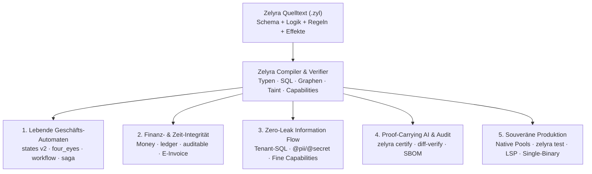

# Zelyra 2.0 Vision & Anforderungsspezifikation: Die weltweit erste *Proof-Carrying Business Language*

> **Leitbild:** In anderen Sprachen *hoffst* du, dass dein Geschäftsprozess, dein Geld, deine Mandantengrenze und deine Compliance stimmen. In Zelyra **beweist der Compiler** sie – und liefert den maschinenlesbaren Nachweis gleich mit.

**Status dieses Dokuments:** Strategische Architektur- und Anforderungsspezifikation ab **Zelyra 1.3.6** (`✅ Veröffentlicht`) für die geplante Versionsreihe **1.4.0 → 2.0.0** (`🗺️ Geplant`). Alle neuen Syntaxbeispiele in diesem Dokument sind ausdrücklich **Spezifikationsentwürfe** und gelten erst nach Implementierung, positiven/negativen Tests, Sicherheitsprüfung und Release als verfügbar (gemäß [Manifest](MANIFESTO.de.md) und [AGENTS.md](../AGENTS.md)).

[English version](VISION-2.0.en.md) · Deutsch

---

## 1. Warum Zelyra mehr als nur eine Daseinsberechtigung braucht

Die Welt braucht nicht die vierundzwanzigste allgemeine Web-Sprache und kein weiteres „Laravel/Rails/Django in Rust nachgebaut“. Gegen reife Ökosysteme wie TypeScript, Go, Rust, PHP/Laravel, Python/Django oder Java/Spring gewinnt man nicht über die größte Paketbibliothek – man gewinnt nur über **eine eigene Kategorie**, die diese Sprachen strukturell nicht nachrüsten können.

Mit **Zelyra 1.3.6** existiert bereits das Fundament einer solchen Kategorie:
- ✅ Datenmodell (`table`), Typen, parametrisiertes SQL, Formulare, CRUD, Authentifizierung, Contracts (`requires`/`ensures`) und Capabilities (`uses`) leben in **einer einzigen statisch geprüften Sprache**.
- ✅ Deklarative Tabellen-Zustandsmaschinen (`states` + reine `when`-Guards) verbinden Schema, Graph-Verifikation (`zelyra verify`), Row-Lock-Laufzeit (`SELECT ... FOR UPDATE`), Formular-`<select>` und Mermaid-Dokumentation (`zelyra doc --states`).
- ✅ Kontrollfluss-Entscheidungstransaktionen (`transaction { ... }`) und `?`-Fehlerpropagierung verbinden Ergonomie mit automatischem Datenbank-Rollback.
- ✅ Compilergeprüfte, fail-closed Mehrtabellen-Mandanten-`SELECT`-Abfragen beweisen erstmals statisch, dass selbst `LEFT JOIN`-Ausschlussabfragen keine Mandantendaten mischen.

**Der strategische Befund:** Genau hier liegt Zelyras weltweit einmalige Chance. Niemand sonst vereint **Geschäftslogik, relationales Schema, Zustandsgraphen, Buchhaltungs-Invarianten, Mandanten- & Datenschutz-Datenflüsse sowie KI-Verifikation** in einem einzigen souveränen Compiler.

**Zelyras Zielbild bis 2.0.0:**
> **Zelyra wird die weltweit erste *Proof-Carrying Business Language* (beweistragende Geschäftssprache) – eine souveräne, telemetriefreie Sprache für geschäftskritische Anwendungen, deren Compiler Korrektheit, Mandanten-Isolation, Buchhaltungs-Integrität, Datenschutzflüsse und KI-generierte Änderungen nicht nur prüft, sondern als kryptografisch überprüfbares Zertifikat mitliefert.**

---

## 2. Die fünf einzigartigen Säulen von Zelyra 2.0



### Säule 1: Lebende Geschäfts-Automaten (`states` v2, `four_eyes` & `workflow`) `🗺️ 1.5.0`
In klassischer Software sind Geschäftsprozesse auf Controller, Cronjobs, Status-Strings und Wiki-Seiten zerstreut. In Zelyra **ist der Quelltext der geprüfte Prozess**:
- **Natives Vier-Augen-Prinzip (`requires four_eyes`):** Der Compiler und die Laufzeit garantieren, dass Ersteller und Freigeber eines Übergangs unterschiedliche authentifizierte Identitäten sind – unveränderlich im Audit-Log belegt.
- **Rollen- und Kind-Aggregat-Guards:** `when`-Übergänge prüfen typisiert Rollen (`session.role`) und gekoppelte Kind-Sammlungen (`all(items, i => i.qty > 0)`).
- **Zeitgebundene Workflows & Kompensations-Sagas:** Deklarative Fristen (`after 14 days in sent -> overdue`) und atomare `on enter` / `compensate`-Aktionen laufen direkt über den residenten Scheduler und die MariaDB-/PostgreSQL-Outbox – mit statischem Deadlock- und Erreichbarkeitsbeweis in `zelyra verify`.

```zelyra
# 🗺️ Spezifikationsentwurf (1.5.0)
table purchase_orders scoped by tenant_id: TenantId {
    id: Id primary auto
    tenant_id: TenantId required
    created_by: UserId required
    total: Money<EUR> required
    status: String(24) required default "draft"

    states status {
        draft -> pending_approval when total > money("0.00", EUR) : "Betrag muss positiv sein."
        pending_approval -> approved
            requires role("approver")
            requires four_eyes(created_by)
        pending_approval -> rejected requires role("approver")
        approved -> paid
        paid -> final
        rejected -> final
    }

    workflow reminders on status {
        after 5 days in pending_approval -> escalate_approval
    }
}
```

### Säule 2: Finanz- und Zeit-Integrität als Sprachkonstrukt (`Money<C>`, `ledger`, `auditable`, E-Invoicing) `🗺️ 1.6.0`
Kaufmännische Software scheitert nicht an Syntax, sondern an vermischten Währungen, stillen Rundungsfehlern, nachträglich manipulierten Buchungen und kaputten Zeitreihen.
- **Typisierte Währungen (`Money<EUR>`, `Money<USD>`):** `eur + usd` ist ein Compilerfehler (`E-TYPE-001`). Umrechnungen erfordern expliziten Wechselkurs, Zeitstempel und Rundungsmodus.
- **Deklaratives Nullsummen-Ledger (`ledger`):** Doppelte Buchführung als Sprachprimitiv. Jede Buchungsgruppe muss `sum(debit) == sum(credit)` erfüllen; der Compiler verbietet `UPDATE` und `DELETE` auf Ledger-Tabellen vollständig (Storno ausschließlich per Gegenbuchung) und verkettet Einträge kryptografisch.
- **Bitemporale Historie (`auditable` + `as_of`):** Eine Deklaration am `table`-Schema ermöglicht revisionssichere Zeitreisen (*„Wie war der Vertrags- und Preisstand am 31.12.2025?“*) ohne handgeschriebene Trigger-Monster.
- **Typisierte E-Rechnungen (Factur-X / ZUGFeRD / XRechnung):** Schemageprüfte Erzeugung, Validierung und transaktionales Anhängen von XML + PDF/A-3 direkt über die Outbox.

```zelyra
# 🗺️ Spezifikationsentwurf (1.6.0)
ledger journal_entries scoped by tenant_id: TenantId {
    id: Id primary auto
    tenant_id: TenantId required
    booking_date: Date required
    account: AccountCode required
    debit: Money<EUR> required default money("0.00", EUR)
    credit: Money<EUR> required default money("0.00", EUR)
    # Compiler + Laufzeit erzwingen: append-only & sum(debit) == sum(credit) je Buchungsgruppe
}
```

### Säule 3: Zero-Leak Information Flow & ressourcengenaue Capabilities (`@pii`, `@secret`, Tenant-SQL-Algebra) `🗺️ 1.7.0`
Keine Mainstream-Websprache verhindert zur Compile-Zeit, dass eine IBAN versehentlich im Log landet oder ein mandantenübergreifendes `UPDATE` fremde Daten berührt.
- **Erweiterte Mandanten-SQL-Algebra:** Fail-closed-Beweise nicht nur für `INNER`/`LEFT JOIN`-`SELECT`, sondern auch für geprüfte `WITH`-CTEs, Aggregationen (`GROUP BY`/`HAVING`) und mandantensichere Batch-Writes.
- **Typisiertes Datenschutz-Taint-Tracking (`@pii`, `@secret`, `@redact`):** Werte aus `@pii`- oder `@secret`-Spalten dürfen niemals unredigiert in `print()`, Logs, Fehlerseiten, unautorisierte HTML-Views oder fremde `Network`-Aufrufe fließen (`E-PRIVACY-001`).
- **Compiler-generierte DSGVO-Werkzeuge (`zelyra privacy map|export|erase`):** Der Compiler kennt jede `@pii`-Spalte, jeden Fremdschlüssel und jede gesetzliche Aufbewahrungssperre (`guard delete` / `ledger`) und leitet daraus geprüfte Auskunfts- und Löschpläne ab.
- **Feingranulare Capabilities:** `uses Database(read: [customers], write: [invoices])`, `uses Network(allow: ["api.datev.de"])`, `uses FileSystem(scope: "exports/")` – echtes Least-Privilege auf Funktions- und Paketebene.

### Säule 4: *Proof-Carrying Software* & KI-Verifikations-Schleife (`zelyra certify`, `zelyra diff-verify`) `🗺️ 1.8.0`
Wenn KI-Agenten 80 % des Routinetexts schreiben, wird **Vertrauen zum wertvollsten Gut**. Zelyra ist die perfekte Sprache für das KI-Zeitalter, weil der Compiler dem Menschen und Prüfern harte Fakten liefert statt KI-Erklärungen zu glauben:
- **`zelyra certify <entry.zyl> --output zelyra-proof.json`:** Erzeugt ein kryptografisch signiertes, reproduzierbares Beweis- und Compliance-Zertifikat: alle `PROVEN`/`RUNTIME_CHECK`-Verträge, State-Machine-Graphen, Mandanten-SQL-Beweise, `@pii`-Datenflüsse, Capability-Allowlists, `ledger`-Integrität, `strict_architecture`-Status und SPDX-SBOM.
- **`zelyra diff-verify <base> <head> --format=json`:** Semantische PR-Prüfung für Teams und KI-Code-Reviews. Meldet maschinenlesbar: *„Keine Mandantengrenze gelockert, kein `states`-Guard entfernt, keine neue `Network`-Capability eingeführt, alle neuen `@pii`-Felder abgedeckt.“*
- **Kontrolliertes Single-Binary-Deployment (`zelyra build --bundle`):** Ein reproduzierbares Produktions-Binary samt geprüften Assets und eingebettetem Proof-Zertifikat – ohne Node, ohne Composer, ohne Cloud-Zwang.

### Säule 5: Souveräne Produktionsreife & Entwicklerfreude (Native DB-Pools, `zelyra test`, LSP) `🗺️ 1.4.0`
Eine geniale Vision überzeugt nur, wenn der Entwickler-Alltag sich mühelos, schnell und rock-solid anfühlt:
- **Native Datenbank-Treiber & Connection Pooling** für MariaDB/MySQL und PostgreSQL auf echter Laufzeit-Parität (Ablösung des externen CLI-Subprozess-Pfads im Laufzeitbetrieb).
- **Erstklassiges `zelyra test`:** Eingebauter Test-Runner mit paralleler Ausführung, automatischer Transaktions-Rollback-Sandbox pro Datenbanktest, Contract-/Property-Tests und deterministischer Coverage.
- **Vollwertiger `zelyra lsp`:** Standard-LSP für VS Code, Zed, Neovim, JetBrains und Zelyra Studio (Live-Diagnosen, Hover-Typen & Contracts, Go-to-Definition, Rename, SQL-/State-/Record-Completion, Code Actions).
- **Tägliche Sprachergonomie:** String-Interpolation (`"Rechnung {nr} über {total}"`), generische Hilfsfunktionen, ergonomische Standardbibliothek und verlustfreie Zero-Downtime-Schema-Migrationen (`expand -> backfill -> contract`).

---

## 3. Bewusste Anti-Goals (Was Zelyra ausdrücklich *nicht* baut)

Fokus schlägt Feature-Brei. Zelyra lehnt bewusst ab:
1. **Kein weiterer allgemeiner Frontend-SPA-Framework-Klon:** Kein virtuelles DOM, kein npm-Ökosystem, kein Nachbau von React/Vue. Zelyra liefert serverseitiges, sicheres, typgeprüftes HTML, Zelyra UI (CSS) und saubere OpenAPI-/TypeScript-Grenzen für Teams, die ein separates Frontend wünschen.
2. **Kein magisches ORM, das SQL versteckt:** SQL bleibt First-Class, sichtbar und compilergeprüft.
3. **Keine unbegrenzte dynamische Metaprogrammierung / Runtime-Eval:** Alles Sicherheitsrelevante muss statisch auflösbar, prüfbar und für Mensch wie KI deterministisch nachvollziehbar bleiben.
4. **Keine ungeprüften Plugin-Ökosysteme oder Cloud-Abhängigkeiten:** Keine Telemetrie, kein Pflicht-Account, kein implizites Code-Nachladen; optionale Erweiterungen (z. B. Wasm in 1.8.0) laufen ausschließlich unter strengen Capability- und Ressourcen-Limits.
5. **Keine unehrlichen Beweisversprechen:** `PROVEN`, `RUNTIME_CHECK`, `UNPROVEN` und `FAILED` bleiben heilig.

---

## 4. Verbindliche Versions-Roadmap & Anforderungen (`1.4.0` → `2.0.0`)

Jede Version hat ein klares strategisches Ziel, konkrete funktionale Anforderungen, verpflichtende Sicherheits- und Negativtests sowie ein hartes Exit-Kriterium. Kein Release gilt als abgeschlossen, solange ein Pflichtkriterium offen ist.

---

### Release `1.4.0` — **Production Core & Developer Joy**
**Strategisches Ziel:** Den Sprung vom starken Compiler-Kern zur kompromisslos produktionstauglichen, freudig entwickelbaren Sprache schaffen – bewiesen an einer echten nativen Geschäftsanwendung.

#### Anforderungen
1. **Native Datenbank-Treiber & Connection Pool (MariaDB/MySQL + PostgreSQL):**
   - Echte native, gepoolte Datenbankverbindungen für Abfragen, Entscheidungstransaktionen (`transaction { ... }`), Row-Locks und Outbox-Worker – ohne `mariadb`-/`psql`-Subprozess-Spawning pro Query.
   - Konfigurierbare Pool-Größen, Verbindungs-Timeouts, Statement-Deadlines und automatisches Rollback bei Verbindungsabbruch.
   - Volle Laufzeitparität zwischen MariaDB und PostgreSQL für CRUD, `states`, Entscheidungstransaktionen, Auth, Sessions und Outbox.
2. **Erstklassiger Test-Runner (`zelyra test`):**
   - Deklarative `test "..." { ... }`-Blöcke in `tests/*.zyl` und `tests.zyl` mit `assert`, `assert_eq`, `assert_err`, `assert_ok`.
   - Automatische DB-Transaktions-Sandbox (`test "..." uses Database`): jeder Datenbanktest läuft isoliert und rollt danach sauber zurück.
   - Contract- & Property-Fuzzing (`property "..."` über `requires`/`ensures`), deterministischer Seed, parallele Ausführung und maschinenlesbare `--format=json`-Ausgabe.
3. **Sprachergonomie 1.4:**
   - Typsichere String-Interpolation (`"Rechnung {invoice.number}: {total}"`) mit eindeutigem Escaping (HTML-Kontext bleibt strikt auto-escaped, SQL verbietet String-Interpolation weiterhin kategorisch!).
   - Benutzerdefinierte generische Funktionen (`fn first_or<T>(items: T[], fallback: T) -> T`) über AST, MIR und Bytecode.
4. **Produktionsreifer Language Server (`zelyra lsp`):**
   - Vollständiger LSP-Server (JSON-RPC über stdio) für VS Code, Zed, Neovim und JetBrains: Live-Diagnosen, Hover (Typen, Contracts, Capabilities, `states`), Go-to-Definition, Find References, Symbol-Umbenennung, Formatierung (`zelyra fmt`), Schema-bewusste SQL-/Record-/State-Completion und Quick-Fixes.
5. **Praxis-Härtung (Passwortgenerator & Mini-ERP Benchmark 01):**
   - Abschluss des nativen Passwortgenerators im Work-Modus und Aufbau von Mini-ERP Benchmark 01 (Stammdaten, Mehrlagerbestand mit atomaren Parallelbuchungen, Angebot/Auftrag/Rechnung, Rollen & Audit) nach der Regel `STOP → ANALYSE → BEHEBUNG → TEST → FORTSETZUNG`.

#### Exit-Kriterien (`1.4.0`)
- Native MariaDB- und PostgreSQL-Pools bestehen nebenläufige Transaktions-, Lock-Timeout- und Rollback-Stresstests.
- `zelyra test` läuft in CI über das gesamte Beispiel- und Benchmark-Portfolio mit 0 Flakes.
- LSP-Integrationstests belegen alle Kern-LSP-Methoden; keine Regression bei SQL-Injection-Schutz durch String-Interpolation (Negativtest: Interpolation in `sql { ... }` bleibt harter Compilerfehler).
- Mini-ERP-Lückenbericht (`LANGUAGE_GAPS.md`) dokumentiert alle geschlossenen und ggf. offen verbliebenen Punkte ehrlich.

---

### Release `1.5.0` — **Living Business Processes (`states` v2, `four_eyes` & `workflow`)**
**Strategisches Ziel:** Zelyra zur besten Sprache der Welt für überprüfbare, langlebige Geschäftsprozesse machen.

#### Anforderungen
1. **Erweiterte Zustandsmaschinen (`states` v2):**
   - Rollen- und Berechtigungsbedingungen direkt an Übergängen: `draft -> approved requires role("approver")`.
   - **Natives Vier-Augen-Prinzip (`requires four_eyes(<creator_col>)`):** Compiler prüft Existenz und Identitätstyp der Ersteller-Spalte; Laufzeit vergleicht unter `SELECT ... FOR UPDATE` die verifizierte `session.user_id` gegen die Ersteller-Spalte und weist Selbstfreigaben mit HTTP `403`/`422` und Audit-Eintrag ab.
   - Geprüfte Kind-Aggregat-Prädikate in `when`-Guards (z. B. `count(items) > 0`, `all(items, i => i.qty > 0)`), rein und unter Transaktionssperre ausgewertet.
2. **Deklarative Workflows, Fristen & Sagas (`workflow`):**
   - Deklarative Zeitregeln auf `states`-Tabellen (`after <duration> in <state> -> <action_or_state>`), ausgeführt über den residenten Scheduler + Outbox mit idempotenten Leases und `FOR UPDATE SKIP LOCKED`.
   - `on enter <state> { ... }` und `compensate { ... }` mit expliziten Capabilities (`uses Database, Email`), transaktional gekoppelt an den Zustandswechsel.
3. **Erweiterte formale Prozess-Verifikation (`zelyra verify` & `zelyra doc --workflows`):**
   - `zelyra verify` prüft statisch Erreichbarkeit, nicht-finale Sackgassen, potentielle Endlos-Timer-Zyklen und Vier-Augen-Konflikte (z. B. eine Rolle, die gleichzeitig einzige Ersteller- und Freigeber-Rolle ist, wird gemeldet).
   - `zelyra doc --workflows` erzeugt vollständige Mermaid-Prozessdiagramme inklusive Rollen, `[four-eyes]`, `[guarded]` und Timer-Übergängen.

#### Exit-Kriterien (`1.5.0`)
- Positive und negative Tests für `requires four_eyes` (Selbstfreigabe wird garantiert abgewiesen; zweiter autorisierter Benutzer gelingt; Audit-Log protokolliert beide Identitäten).
- Nebenläufigkeitstest: zwei parallele Übergänge auf derselben Zeile serialisieren sauber über `SELECT ... FOR UPDATE` ohne doppelte `on enter`-Ausführung.
- `zelyra verify` und `zelyra doc --workflows` sind deterministisch und in JSON (`zelyra reflect`) abgebildet.

---

### Release `1.6.0` — **Financial & Temporal Integrity (`Money<C>`, `ledger`, `auditable`, E-Invoicing)**
**Strategisches Ziel:** Kaufmännische und prüfungspflichtige Software (ERP, Abrechnung, FinTech, Verträge) mathematisch und revisionssicher im Sprachkern verankern.

#### Anforderungen
1. **Währungssicherer Typ `Money<Currency>`:**
   - Typisierte Währungs-Tags (ISO-4217-Satz wie `EUR`, `USD`, `CHF`, `GBP` oder benutzerdefinierte Währungs-Enums).
   - Addition/Subtraktion/Vergleich nur bei identischer Währung; gemischte Währungen schlagen zur Compile-Zeit fehl (`E-TYPE-001`).
   - Explizite, kursversionierte Umrechnung `convert_money(amount, rate, Rounding::HalfEven)` mit exakter `Decimal`-Arithmetik.
2. **Deklaratives Nullsummen-Ledger (`ledger <name>`):**
   - Sprachkonstrukt `ledger` mit verpflichtendem `debit`/`credit`-Kontenmodell und Buchungsgruppen-ID.
   - **Compilerzwang:** `UPDATE` und `DELETE` auf `ledger`-Tabellen sind ein harter Compile-Zeit-Fehler (`E-LEDGER-001`); Korrekturen erfolgen ausschließlich über typisierte Storno-/Gegenbuchungen.
   - **Nullsummen-Invariante:** Jede `post_ledger { ... }`-Transaktion erzwingt `sum(debit) == sum(credit)` pro Währung vor dem Commit (Rollback bei Ungleichgewicht) und schreibt eine kryptografische Hash-Verkettung pro Mandant.
   - `zelyra ledger verify <entry.zyl>` prüft Nullsummen- und Hash-Ketten-Integrität gegen die Datenbank.
3. **Bitemporale Historie (`auditable` + `as_of`):**
   - `table contracts auditable { ... }` erzeugt automatisch gültigkeitsversionierte Historien-Tabellen (`valid_from`, `valid_to`, `recorded_at`, `recorded_by`).
   - Typgeprüfte Zeitreise-Abfragen `sql<Contract[]> { ... AS OF :timestamp }` für historische Stichtags-Auswertungen.
4. **Typisierte E-Rechnungen (Factur-X / ZUGFeRD / XRechnung):**
   - Erstklassiger, typsicherer E-Rechnungs-Generator & -Validator (EN 16931 Kernprofil), mit sicherer XML-Serialisierung (XXE-frei, keine String-Konkatenation) und Einbettung als PDF/A-3 + XML-Anhang in die transaktionale `mail_queue`-Outbox.

#### Exit-Kriterien (`1.6.0`)
- Negativtests belegen: `Money<EUR> + Money<USD>` scheitert zur Compile-Zeit; `UPDATE`/`DELETE` auf `ledger` scheitert zur Compile-Zeit (`E-LEDGER-001`); unausgeglichene Buchungen rollen atomar zurück.
- E-Rechnungs-Testsuite validiert erzeugtes Factur-X/XRechnung-XML gegen EN-16931-Regeln und verifiziert atomares Rollback in der Outbox.
- `as_of`-Abfragen liefern deterministische historische Zustände über MariaDB und PostgreSQL.

---

### Release `1.7.0` — **Zero-Leak Information Flow & Fine-Grained Capabilities**
**Strategisches Ziel:** Datenschutz, Mandanten-Isolation und Least-Privilege-Sicherheit von einer „Best Practice“ zu einer **statisch bewiesenen Spracheigenschaft** machen.

#### Anforderungen
1. **Vollständige Mandanten-SQL-Algebra (Fail-Closed):**
   - Erweiterung von `verify_tenant_scoped_select` um geprüfte nicht-rekursive `WITH`-CTEs, Aggregationen (`GROUP BY`, `HAVING`, `COUNT`/`SUM`/`MIN`/`MAX`) und mandantensichere `UPDATE`/`DELETE`-Anweisungen in `program.functions` – bei unverändert strengem nominalem `TenantId`-Beweis.
   - Jede mehrdeutige, unbewiesene oder ungetypte Abfrage bleibt fail-closed (`E-TENANT-003`).
2. **Information-Flow- & Datenschutz-Taint-Tracking (`@pii`, `@secret`, `@redact`):**
   - Spalten- und Record-Feld-Annotationen `@pii` (personenbezogene Daten) und `@secret` (Geheimnisse/Tokens).
   - **Zero-Leak-Analyse im Compiler (`E-PRIVACY-001`):**
     - `@secret`-Werte dürfen niemals an `print`, Logs, HTML-Templates, Fehlermeldungen oder unmarkierte API-Responses fließen.
     - `@pii`-Werte dürfen nicht in technische Logs oder öffentliche/unauthentifizierte Routen fließen, es sei denn über explizite, geprüfte Redaktion (`redact(val)`) oder autorisierte Empfänger-Pfade.
3. **Automatischer DSGVO-Datenkatalog (`zelyra privacy`):**
   - `zelyra privacy map <entry.zyl> [--format=json|md]` generiert ein lückenloses Verarbeitungsverzeichnis aller `@pii`-Felder, Tabellen, Routen und externen `Network`/`Email`-Senken.
   - `zelyra privacy export-plan` / `erase-plan` leitet aus Fremdschlüsseln, `@pii`-Markierungen und `ledger`/`guard delete`-Aufbewahrungspflichten geprüfte Auskunfts- und Lösch-/Anonymisierungspläne ab.
4. **Ressourcengenaue Capabilities:**
   - Feingranulare Effekt-Signaturen: `uses Database(read: [customers], write: [invoices])`, `uses Network(allow: ["api.datev.de"])`, `uses FileSystem(scope: "exports/")`, `uses Email(templates: ["invoice_notice"])`.
   - Statische und Laufzeit-Durchsetzung; Pakete (`pkg:`) dürfen niemals stillschweigend breitere Rechte anfordern als im Lockfile/Manifest genehmigt.

#### Exit-Kriterien (`1.7.0`)
- Umfassende Negativ-Testmatrix für Information-Flow-Leaks (`@secret` in `print`, `@pii` in ungeschützter `page`, Umgehung über String-Verkettung/Record-Kopie/Hilfsfunktionen → alle mit `E-PRIVACY-001` abgewiesen).
- Mandanten-Isolationstests für CTEs, Aggregationen und Batch-Writes auf MariaDB und PostgreSQL.
- `zelyra privacy map` erzeugt 100 % deterministische, vollständige DSGVO-Inventare für das Mini-ERP-Referenzprojekt.

---

### Release `1.8.0` — **Proof-Carrying Software, AI-Verified Engineering & Sovereign Deployment**
**Strategisches Ziel:** Den Compiler-Beweis als eigenständiges, handelbares und prüfbares Produkt-Artefakt liefern – für Audits, regulierte Branchen, DevSecOps und KI-gestützte Entwicklungsteams.

#### Anforderungen
1. **Signiertes Compiler-Zertifikat (`zelyra certify`):**
   - Erzeugt ein deterministisches, Ed25519-signierbares `zelyra-proof.json` (plus menschenlesbaren HTML/Markdown-Prüfbericht) mit vollständigem Nachweis über:
     - `PROVEN` / `RUNTIME_CHECK` / `UNPROVEN` Contracts (`requires`/`ensures`),
     - alle `states`- und `workflow`-Graph-Beweise (inkl. `four_eyes`),
     - alle Mandanten-SQL-Beweise und fail-closed Grenzen,
     - alle `@pii`/`@secret`-Datenfluss-Beweise,
     - die vollständige Capability-Matrix (Funktionen, Routen, Pakete),
     - `ledger`-Unveränderlichkeit, `strict_architecture`-Konformität und SPDX-SBOM.
   - `zelyra certify --verify <proof.json>` prüft Signatur und Quellcode-Hash offline und reproduzierbar.
2. **Semantische PR- & KI-Diff-Verifikation (`zelyra diff-verify`):**
   - Vergleicht zwei Git-Stände semantisch statt nur zeilenweise und gibt ein maschinenlesbares Sicherheits-Delta aus (neue Capabilities, geänderte Mandantengrenzen, entfernte `states`-Guards, neue `@pii`-Senken, aufgeweichte Contracts).
   - CI-Gate-Modus (`--fail-on-privilege-escalation`) für automatisierte KI-PR-Prüfungen.
3. **Single-Binary-Deployment (`zelyra build --bundle`) & Bytecode-Standard-Gate:**
   - Verpackt Zelyra-Laufzeit, geprüften Anwendungs-Stand, lokale UI-/Public-Assets und optionales Proof-Zertifikat in ein einzelnes, portables, telemetriefreies Produktions-Binary.
   - **Bytecode-Standard-Gate:** Bytecode wird nur dann Standard-Backend, wenn vollständige Differential-Parität über alle 1.4–1.8-Features (inkl. Entscheidungstransaktionen, Mandanten-SQL, `states`), sicheres Fail-Closed-Verhalten und ein reproduzierbar gemessener Performance-/Speichervorteil belegt sind; andernfalls bleibt AST ehrlich Standard.
   - Optionale Wasm-Erweiterungen nur unter expliziter Capability-, Speicher-, Zeit- und Vertrauens-Sandbox.

#### Exit-Kriterien (`1.8.0`)
- Zwei unabhängige Builds erzeugen bit-identische `zelyra-proof.json`-Manifeste; Manipulation einer einzigen Zeile Quellcode oder Zertifikat führt zum Fehlschlag von `zelyra certify --verify`.
- `zelyra diff-verify` erkennt gezielt eingeschleuste Privilege-Escalations (neue `Network`-Capability, entfernter `when`-Guard, gelockerter `TenantId`-Filter) zuverlässig.
- `zelyra build --bundle` startet die Mini-ERP-Referenzanwendung als einzelnes Binary auf einem frischen Linux-System ohne Rust, Node oder externe Webserver-Abhängigkeiten.

---

### Release `1.9.0` — **2.0 Hardening, Zero-Downtime Migrations & Studio Polish**
**Strategisches Ziel:** Produktionsreife ohne Kompromisse – Feature-Freeze, Betriebshärtung und erstklassige visuelle Inspektionswerkzeuge.

#### Anforderungen
1. **Feature-Freeze:** Keine neuen Sprach-Großfeatures; ausschließlicher Fokus auf Stabilität, Fehlermeldungen, Diagnosequalität, Sicherheit und Performance.
2. **Zero-Downtime-Schema-Migrationen (`zelyra db plan --zero-downtime`):**
   - Automatisierte Erkennung destruktiver DDL-Schritte (`DROP COLUMN`, inkompatible Typänderung, sperrende `NOT NULL`-Einführung) mit sicherem 3-Phasen-Plan (`expand -> backfill -> contract`).
3. **Zelyra Studio 2.0 (Inspektions- & Visualisierungs-Plattform):**
   - Interaktiver **Schema-, State-Machine-, Workflow- und `@pii`-Datenfluss-Explorer** direkt aus dem Compiler-Modell (Quellcode bleibt die einzige Source of Truth – keine zweite visuelle Wahrheit!).
   - Integrierte Test-, Verify- und Certify-Ansicht sowie kontrollierte visuelle Formular- und Theme-Anpassung mit Hash-geprüftem Diff.
4. **Observability ohne Telemetrie:**
   - Opt-in lokaler OpenTelemetry-/Prometheus-Metrik-Endpunkt (`/__zelyra/metrics`, standardmäßig auf Loopback/geschützt) für Latenz, Pool-Auslastung, Outbox-Tiefe und Transaktions-Rollbacks – 0 % Phone-Home.
5. **Vollständige Verifikation & Dokumentation:**
   - Unabhängige Sicherheits-Review-Checkliste, Last-/Concurrency-Benchmarks mit veröffentlichten Messwerten, vollständige zweisprachige Handbücher (DE & EN) und Upgrade-Leitfaden `1.x -> 2.0`.

#### Exit-Kriterien (`1.9.0`)
- 0 offene kritische/hohe Sicherheits- oder Datenverlust-Bugs; automatischer CI-Regressionstest beweist 0 ungefragte ausgehende Netzwerkverbindungen (No-Telemetry-Gate).
- Alle Handbuch-Beispiele sind automatisiert typ- und ausführungsgeprüft.

---

### Release `2.0.0` — **The Proof-Carrying Business Language (LTS)**
**Strategisches Ziel:** Die erste vollständige Langzeit-Plattformversion, auf die Unternehmen, Behörden, Freelancer und KI-gestützte Teams produktiv und souverän aufbauen können.

#### Verbindliche Garantien von Zelyra `2.0.0`
- **Stabile Sprachlinie `1.0`:** Dokumentierte Kompatibilitäts- und Deprecation-Garantie (mindestens 3 Jahre LTS-Wartung für kritische Sicherheits- und Korrektheitsfixes).
- **Verbindliche Maschinenverträge:** Versionierte Spezifikationen für `zelyra reflect`, `zelyra certify` (`zelyra-proof.json`), `zelyra diff-verify`, `zelyra lsp`, `zelyra.lock` und Zelyra-UI-CSS.
- **Bewiesene Praxis-Referenz:** Vollständige, öffentlich reproduzierbare Referenz-Geschäftsanwendung (Mini-ERP inkl. Mandanten, `states`/`four_eyes`, `ledger`, `@pii`, Factur-X-E-Rechnung, Single-Binary-Bundle und signiertem `zelyra-proof.json`) als lebender Beweis.
- **100 % Souveränität:** Vollständig lokal entwickel-, prüf-, zertifizier- und betreibbar – ohne Cloud-Zwang, ohne Telemetrie, ohne Fremd-Lock-in.
