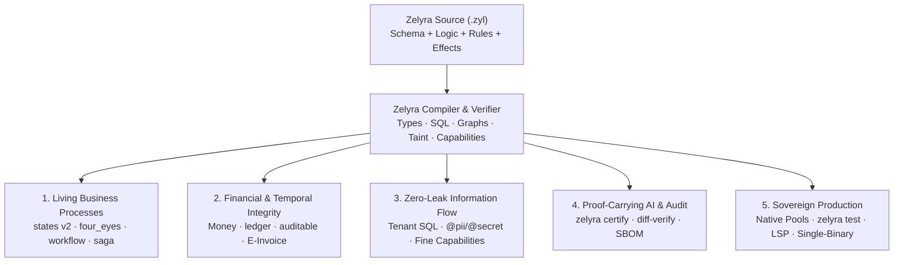

# Zelyra 2.0 Vision & Release Requirements: The World's First *Proof-Carrying Business Language*

> **Guiding thesis:** In other languages, you *hope* your business process, money math, tenant boundary, and compliance hold in production. In Zelyra, **the compiler proves them**—and ships the machine-verifiable certificate alongside your application.

**Document status:** Strategic architecture and release requirements specification starting from **Zelyra 1.3.6** (`✅ Released`) for the planned **1.4.0 → 2.0.0** sequence (`🗺️ Planned`). All new syntax examples in this document are explicitly **design specifications** and are not treated as shipped until implemented, backed by positive and negative tests, security-reviewed, and released (per [MANIFESTO.md](MANIFESTO.md) and [AGENTS.md](../AGENTS.md)).

English · [Deutsche Fassung](VISION-2.0.de.md)

---

## 1. Why Zelyra Needs More Than Just a Right to Exist

The world does not need a twenty-fourth general-purpose web language or another "Laravel/Rails/Django rewritten in Rust." You cannot out-ecosystem TypeScript, Go, Rust, PHP/Laravel, Python/Django, or Java/Spring by copying them—you win only by **creating a category** those ecosystems cannot structurally retrofit.

With **Zelyra 1.3.6**, the foundation of that category already exists:
- ✅ Data schema (`table`), types, parameterized SQL, forms, CRUD, authentication, contracts (`requires`/`ensures`), and capabilities (`uses`) live in **one statically verified language**.
- ✅ Declarative table state machines (`states` + pure `when` guards) unify schema, static graph verification (`zelyra verify`), row-locked runtime enforcement (`SELECT ... FOR UPDATE`), state-aware form `<select>`s, and Mermaid diagrams (`zelyra doc --states`).
- ✅ Control-flow decision transactions (`transaction { ... }`) and postfix `?` propagation combine clean ergonomics with automatic database rollback.
- ✅ Compiler-verified, fail-closed multi-table tenant `SELECT` queries statically prove that even `LEFT JOIN` exclusion queries cannot leak cross-tenant data.

**Strategic conclusion:** This is Zelyra's truly unique wedge. No mainstream language unifies **business logic, relational schemas, state graphs, accounting invariants, tenant & privacy data flows, and AI-change verification** inside a single sovereign compiler.

**Zelyra's 2.0.0 destination:**
> **Zelyra becomes the world's first *Proof-Carrying Business Language*—a sovereign, telemetry-free language for mission-critical business software whose compiler not only checks correctness, tenant isolation, accounting integrity, privacy flows, and AI-generated changes, but emits a cryptographically verifiable certificate proving them.**

---

## 2. The Five Unique Pillars of Zelyra 2.0



### Pillar 1: Living Business Processes (`states` v2, `four_eyes`, and `workflow`) `🗺️ 1.5.0`
In conventional stacks, business lifecycles are scattered across controllers, cron jobs, status strings, and outdated wikis. In Zelyra, **the source code is the verified process**:
- **Native four-eyes principle (`requires four_eyes`):** Compiler and runtime enforce that creator and approver are distinct authenticated identities—recorded immutably in the audit log.
- **Role & child-aggregate guards:** `when` transitions type-check caller roles (`session.role`) and child collections (`all(items, i => i.qty > 0)`).
- **Time-bound workflows & compensating sagas:** Declarative deadlines (`after 14 days in sent -> overdue`) and atomic `on enter` / `compensate` hooks run on the resident scheduler and transactional outbox—statically checked for deadlocks and unreachable states in `zelyra verify`.

```zelyra
# 🗺️ Design specification (1.5.0)
table purchase_orders scoped by tenant_id: TenantId {
    id: Id primary auto
    tenant_id: TenantId required
    created_by: UserId required
    total: Money<EUR> required
    status: String(24) required default "draft"

    states status {
        draft -> pending_approval when total > money("0.00", EUR) : "Amount must be positive."
        pending_approval -> approved
            requires role("approver")
            requires four_eyes(created_by)
        pending_approval -> rejected requires role("approver")
        approved -> paid
        paid -> final
        rejected -> final
    }

    workflow reminders on status {
        after 5 days in pending_approval -> escalate_approval
    }
}
```

### Pillar 2: Financial & Temporal Integrity as First-Class Primitives (`Money<C>`, `ledger`, `auditable`, E-Invoicing) `🗺️ 1.6.0`
Commercial systems rarely fail on syntax; they fail on mixed currencies, silent rounding drift, mutated financial history, and broken time travel.
- **Currency-safe `Money<EUR>`, `Money<USD>`:** `eur + usd` is a compile-time error (`E-TYPE-001`). Conversions require an explicit exchange rate, timestamp, and rounding mode.
- **Declarative zero-sum `ledger`:** Double-entry accounting as a language primitive. Every posting group must satisfy `sum(debit) == sum(credit)`; the compiler forbids `UPDATE` and `DELETE` on ledger tables outright (corrections occur only via reversing entries) and chains entries with cryptographic hashes.
- **Bitemporal history (`auditable` + `as_of`):** One schema annotation enables audit-ready point-in-time queries (*"What was the contract and price state on 2025-12-31?"*) without brittle hand-written triggers.
- **Typed structured e-invoicing (Factur-X / ZUGFeRD / XRechnung):** Schema-validated XML + PDF/A-3 generation attached atomically via the transactional outbox.

```zelyra
# 🗺️ Design specification (1.6.0)
ledger journal_entries scoped by tenant_id: TenantId {
    id: Id primary auto
    tenant_id: TenantId required
    booking_date: Date required
    account: AccountCode required
    debit: Money<EUR> required default money("0.00", EUR)
    credit: Money<EUR> required default money("0.00", EUR)
    # Compiler + runtime enforce: append-only & sum(debit) == sum(credit) per posting group
}
```

### Pillar 3: Zero-Leak Information Flow & Fine-Grained Capabilities (`@pii`, `@secret`, Tenant SQL Algebra) `🗺️ 1.7.0`
No mainstream web language proves at compile time that an IBAN cannot accidentally slip into application logs or that a batch `UPDATE` cannot cross tenant boundaries.
- **Expanded tenant SQL algebra:** Fail-closed proofs extended to non-recursive `WITH` CTEs, aggregations (`GROUP BY`/`HAVING`), and tenant-safe batch `UPDATE`/`DELETE`—always bound to one nominal `TenantId`.
- **Typed privacy & secret taint tracking (`@pii`, `@secret`, `@redact`):** Values flowing from `@pii` or `@secret` columns cannot reach `print()`, logs, error pages, unauthenticated views, or arbitrary `Network` sinks unredacted (`E-PRIVACY-001`).
- **Compiler-derived GDPR tooling (`zelyra privacy map|export|erase`):** Because the compiler knows every `@pii` column, foreign key, and retention lock (`guard delete` / `ledger`), it generates complete processing registers and verified export/erasure plans directly from source.
- **Resource-scoped capabilities:** `uses Database(read: [customers], write: [invoices])`, `uses Network(allow: ["api.datev.de"])`, `uses FileSystem(scope: "exports/")`—true least-privilege per function and package.

### Pillar 4: *Proof-Carrying Software* & AI-Verified Engineering (`zelyra certify`, `zelyra diff-verify`) `🗺️ 1.8.0`
When AI assistants draft 80% of boilerplate, **trust becomes the scarce resource**. Zelyra shines in the AI era because the compiler gives humans and auditors verifiable facts instead of asking them to trust model explanations:
- **`zelyra certify <entry.zyl> --output zelyra-proof.json`:** Produces a reproducible, Ed25519-signable proof and compliance certificate covering all `PROVEN`/`RUNTIME_CHECK` contracts, state/workflow graphs, tenant SQL proofs, `@pii` information flows, capability allowlists, `ledger` integrity, `strict_architecture` status, and SPDX SBOM.
- **`zelyra diff-verify <base> <head> --format=json`:** Semantic PR verification for humans and AI agents: *"No tenant boundary weakened, no `states` guard removed, no new `Network` capability added, all new `@pii` fields accounted for."*
- **Sovereign single-binary deployment (`zelyra build --bundle`):** Packages runtime, checked app artifacts, local UI assets, and optional proof certificate into one portable production binary—zero Node, zero Composer, zero cloud lock-in.

### Pillar 5: Sovereign Production Core & Developer Joy (Native DB Pools, `zelyra test`, LSP) `🗺️ 1.4.0`
A bold vision only wins adoption if daily development feels fast, ergonomic, and dependable:
- **Native database drivers & connection pooling** for MariaDB/MySQL and PostgreSQL at full runtime parity (retiring external CLI-subprocess execution on runtime paths).
- **First-class `zelyra test`:** Built-in parallel test runner with automatic per-test DB transaction rollback sandboxes, contract/property fuzzing, and JSON reporting.
- **Full `zelyra lsp`:** Standard Language Server for VS Code, Zed, Neovim, JetBrains, and Zelyra Studio (diagnostics, hover types/contracts/states, go-to-definition, rename, SQL/record/state completion, quick fixes).
- **Everyday language ergonomics:** Type-safe string interpolation (`"Invoice {nr}: {total}"`), generic helper functions, and zero-downtime schema migration planning (`expand -> backfill -> contract`).

---

## 3. Deliberate Anti-Goals (What Zelyra Will *Not* Become)

Focus beats feature bloat. Zelyra explicitly rejects:
1. **Not another general-purpose SPA/JS framework clone:** No virtual DOM, no npm toolchain, no React/Vue rebuild. Zelyra delivers server-rendered, type-checked HTML, local Zelyra UI CSS, and crisp OpenAPI/TypeScript boundaries for teams that want a separate frontend.
2. **Not a magic ORM hiding SQL:** SQL stays first-class, visible, and compiler-checked.
3. **Not unrestricted dynamic metaprogramming or runtime `eval`:** Security-critical behavior must remain statically analyzable and deterministic for humans and AI alike.
4. **Not an unvetted plugin jungle or cloud-tethered platform:** Zero telemetry, zero mandatory cloud account, zero silent downloads; optional extensions (e.g., Wasm in 1.8.0) run strictly inside capability and resource sandboxes.
5. **Not dishonest proof marketing:** `PROVEN`, `RUNTIME_CHECK`, `UNPROVEN`, and `FAILED` remain strictly distinct.

---

## 4. Authoritative Release Sequence & Requirements (`1.4.0` → `2.0.0`)

Each release defines a sharp strategic goal, concrete functional requirements, mandatory positive/negative security tests, and hard exit criteria. No release is declared complete while a mandatory gate remains open.

---

### Release `1.4.0` — **Production Core & Developer Joy**
**Strategic goal:** Elevate Zelyra from a strong compiler foundation to a genuinely joyful, production-grade daily driver—proven against a real native business application.

#### Requirements
1. **Native Database Drivers & Connection Pool (MariaDB/MySQL + PostgreSQL):**
   - Native pooled connections for queries, decision transactions (`transaction { ... }`), row locks, and outbox workers—replacing external `mariadb`/`psql` CLI subprocesses on runtime paths.
   - Configurable pool limits, connect/statement deadlines, and guaranteed rollback on connection drop.
   - Full runtime parity between MariaDB and PostgreSQL for CRUD, `states`, decision transactions, auth, sessions, and outbox.
2. **First-Class Test Runner (`zelyra test`):**
   - Declarative `test "..." { ... }` blocks in `tests/*.zyl` and `tests.zyl` with `assert`, `assert_eq`, `assert_ok`, `assert_err`.
   - Automatic DB transaction sandbox (`test "..." uses Database`): every database test executes in an isolated transaction rolled back on completion.
   - Contract/property fuzzing (`property "..."` exercising `requires`/`ensures`), deterministic seeds, parallel execution, and `--format=json`.
3. **Language Ergonomics 1.4:**
   - Type-safe string interpolation (`"Invoice {invoice.number}: {total}"`) with context-aware escaping (HTML auto-escaped; interpolation inside `sql { ... }` remains a hard compile error).
   - User-defined generic functions (`fn first_or<T>(items: T[], fallback: T) -> T`) across AST, MIR, and Bytecode.
4. **Production Language Server (`zelyra lsp`):**
   - Full stdio JSON-RPC LSP for VS Code, Zed, Neovim, and JetBrains: live diagnostics, hover (types, contracts, capabilities, `states`), go-to-definition, references, symbol rename, `zelyra fmt`, schema-aware SQL/record/state completion, and quick fixes.
5. **Real-World Hardening (Password Generator & Mini-ERP Benchmark 01):**
   - Complete the native work-mode password generator and Mini-ERP Benchmark 01 (master data, multi-warehouse atomic concurrent stock bookings, quotes/orders/invoices, roles, audit) strictly via `STOP → ANALYZE → FIX → TEST → RESUME`.

#### Exit Criteria (`1.4.0`)
- Native MariaDB and PostgreSQL pools pass concurrent transaction, lock-timeout, and rollback stress suites.
- `zelyra test` runs across all examples and benchmarks in CI with zero flakes.
- LSP integration tests verify every core method; negative tests confirm string interpolation inside `sql { ... }` is rejected at compile time.
- `LANGUAGE_GAPS.md` honestly records every closed and remaining benchmark finding.

---

### Release `1.5.0` — **Living Business Processes (`states` v2, `four_eyes`, and `workflow`)**
**Strategic goal:** Make Zelyra the best language in the world for verifiable, long-lived business lifecycles.

#### Requirements
1. **State Machines v2 (`states`):**
   - Role and authorization predicates directly on transitions: `draft -> approved requires role("approver")`.
   - **Native four-eyes enforcement (`requires four_eyes(<creator_col>)`):** Compiler verifies creator-column identity type; runtime compares verified `session.user_id` against the creator column under `SELECT ... FOR UPDATE`, rejecting self-approval with HTTP `403`/`422` and an audit entry.
   - Pure child-aggregate predicates inside `when` guards (`count(items) > 0`, `all(items, i => i.qty > 0)`), evaluated under the transaction lock.
2. **Declarative Workflows, Deadlines & Sagas (`workflow`):**
   - Time-based lifecycle rules (`after <duration> in <state> -> <action_or_state>`) backed by the resident scheduler and outbox with idempotent leases and `FOR UPDATE SKIP LOCKED`.
   - `on enter <state> { ... }` and `compensate { ... }` blocks with explicit capabilities (`uses Database, Email`), transactionally bound to state transitions.
3. **Extended Process Verification (`zelyra verify` & `zelyra doc --workflows`):**
   - Static verification of reachability, non-final dead ends, potential timer loops, and four-eyes role conflicts.
   - `zelyra doc --workflows` outputs complete Mermaid process graphs annotated with roles, `[four-eyes]`, `[guarded]`, and timers.

#### Exit Criteria (`1.5.0`)
- Positive and negative tests prove `requires four_eyes` blocks self-approval and logs both identities on approval.
- Concurrency tests prove parallel transitions serialize via `SELECT ... FOR UPDATE` with no duplicate `on enter` firing.
- `zelyra verify`, `zelyra reflect`, and `zelyra doc --workflows` produce deterministic outputs.

---

### Release `1.6.0` — **Financial & Temporal Integrity (`Money<C>`, `ledger`, `auditable`, E-Invoicing)**
**Strategic goal:** Anchor accounting, multi-currency finance, and audit-grade temporal history directly in the language core.

#### Requirements
1. **Currency-Safe `Money<Currency>`:**
   - Typed ISO-4217 currency tags (`EUR`, `USD`, `CHF`, `GBP`, or user currency enums).
   - Arithmetic and comparisons require matching currencies; mixing currencies fails at compile time (`E-TYPE-001`).
   - Explicit rate-versioned conversion `convert_money(amount, rate, Rounding::HalfEven)` using exact `Decimal` math.
2. **Declarative Zero-Sum `ledger <name>`:**
   - First-class double-entry `ledger` declaration with `debit`/`credit` and posting-group identity.
   - **Compile-time append-only rule:** `UPDATE` and `DELETE` against `ledger` tables are compile errors (`E-LEDGER-001`); corrections use typed reversing entries only.
   - **Zero-sum invariant:** Every `post_ledger { ... }` transaction enforces `sum(debit) == sum(credit)` per currency before commit (rolling back on imbalance) and writes a per-tenant cryptographic hash chain.
   - `zelyra ledger verify <entry.zyl>` verifies zero-sum balances and hash-chain integrity against live databases.
3. **Bitemporal History (`auditable` + `as_of`):**
   - `table contracts auditable { ... }` manages validity-versioned history (`valid_from`, `valid_to`, `recorded_at`, `recorded_by`).
   - Type-checked point-in-time queries `sql<Contract[]> { ... AS OF :timestamp }`.
4. **Typed E-Invoicing (Factur-X / ZUGFeRD / XRechnung):**
   - Typed EN 16931 e-invoice generator and validator with safe XML serialization (XXE-free, no string concatenation) and atomic PDF/A-3 + XML attachment via the `mail_queue` outbox.

#### Exit Criteria (`1.6.0`)
- Negative tests prove `Money<EUR> + Money<USD>` fails at compile time, `UPDATE`/`DELETE` on `ledger` fails with `E-LEDGER-001`, and unbalanced ledger writes roll back atomically.
- E-invoice test suite validates emitted Factur-X/XRechnung XML against EN 16931 rules and verifies atomic outbox rollback.
- `as_of` queries return identical historical snapshots on MariaDB and PostgreSQL.

---

### Release `1.7.0` — **Zero-Leak Information Flow & Fine-Grained Capabilities**
**Strategic goal:** Turn privacy, multi-tenant isolation, and least-privilege security from guidelines into **statically proven language properties**.

#### Requirements
1. **Full Tenant SQL Algebra (Fail-Closed):**
   - Extend `verify_tenant_scoped_select` to verified non-recursive `WITH` CTEs, aggregations (`GROUP BY`, `HAVING`, `COUNT`/`SUM`/`MIN`/`MAX`), and tenant-safe batch `UPDATE`/`DELETE` in `program.functions`—always bound to one nominal `TenantId`.
   - Any ambiguous, unproven, or untyped query continues to fail closed (`E-TENANT-003`).
2. **Privacy & Secret Information-Flow Taint Tracking (`@pii`, `@secret`, `@redact`):**
   - Schema and record annotations `@pii` (personal data) and `@secret` (credentials/tokens).
   - **Compile-time zero-leak checker (`E-PRIVACY-001`):**
     - `@secret` values can never reach `print`, logs, HTML templates, error messages, or unmarked API responses.
     - `@pii` values cannot reach technical logs or unauthenticated public routes without explicit checked redaction (`redact(val)`) or authorized recipient flows.
3. **Compiler-Derived GDPR Tooling (`zelyra privacy`):**
   - `zelyra privacy map <entry.zyl> [--format=json|md]` emits a complete processing register of every `@pii` field, table, route, and external `Network`/`Email` sink.
   - `zelyra privacy export-plan` / `erase-plan` derives subject-access and erasure/anonymization plans respecting foreign keys and `ledger`/`guard delete` statutory retention locks.
4. **Fine-Grained Capabilities:**
   - Resource-scoped declarations: `uses Database(read: [customers], write: [invoices])`, `uses Network(allow: ["api.datev.de"])`, `uses FileSystem(scope: "exports/")`, `uses Email(templates: ["invoice_notice"])`.
   - Enforced statically and at runtime; packages (`pkg:`) cannot silently escalate beyond lockfile-approved permissions.

#### Exit Criteria (`1.7.0`)
- Comprehensive negative taint-tracking matrix (`@secret` in `print`, `@pii` in public `page`, bypass attempts via string concatenation/record copies/helper functions → all rejected with `E-PRIVACY-001`).
- Tenant isolation test suite covering CTEs, aggregations, and batch writes on MariaDB and PostgreSQL.
- `zelyra privacy map` generates 100% deterministic GDPR inventories for the Mini-ERP reference app.

---

### Release `1.8.0` — **Proof-Carrying Software, AI-Verified Engineering & Sovereign Deployment**
**Strategic goal:** Deliver compiler proofs as a standalone, verifiable engineering and compliance artifact—for audits, regulated industries, DevSecOps, and AI-assisted teams.

#### Requirements
1. **Signed Compiler Certificate (`zelyra certify`):**
   - Emits a deterministic, Ed25519-signable `zelyra-proof.json` (plus human-readable HTML/Markdown audit report) certifying:
     - `PROVEN` / `RUNTIME_CHECK` / `UNPROVEN` contracts (`requires`/`ensures`),
     - `states` and `workflow` graph proofs (including `four_eyes`),
     - tenant SQL proofs and fail-closed boundaries,
     - `@pii`/`@secret` information-flow proofs,
     - complete capability matrix across functions, routes, and packages,
     - `ledger` immutability, `strict_architecture` compliance, and SPDX SBOM.
   - `zelyra certify --verify <proof.json>` verifies signature and source hashes offline and reproducibly.
2. **Semantic PR & AI Diff Verification (`zelyra diff-verify`):**
   - Compares two Git revisions semantically, emitting a machine-readable security delta (new capabilities, weakened tenant filters, removed `states` guards, new `@pii` sinks, relaxed contracts).
   - CI gate mode (`--fail-on-privilege-escalation`) for automated AI PR review.
3. **Single-Binary Deployment (`zelyra build --bundle`) & Bytecode Default Gate:**
   - Bundles runtime, verified application artifacts, local UI/public assets, and optional proof certificate into one portable, telemetry-free executable.
   - **Bytecode default gate:** Bytecode becomes default only with full differential parity across 1.4–1.8 features (including decision transactions, tenant SQL, `states`), fail-closed safety, and measured performance/memory gains; otherwise AST honestly remains default.
   - Optional Wasm extensions only inside explicit capability, memory, time, and trust sandboxes.

#### Exit Criteria (`1.8.0`)
- Two independent builds emit bit-identical `zelyra-proof.json` manifests; tampering with a single byte of source or certificate fails `zelyra certify --verify`.
- `zelyra diff-verify` catches injected privilege escalations (new `Network` capability, removed `when` guard, weakened `TenantId` filter) reliably.
- `zelyra build --bundle` boots the Mini-ERP reference application as a single executable on a clean Linux host with no Rust, Node, or external web server dependencies.

---

### Release `1.9.0` — **2.0 Hardening, Zero-Downtime Migrations & Studio Polish**
**Strategic goal:** Production excellence without compromises—feature freeze, operational hardening, and first-class visual inspection.

#### Requirements
1. **Feature Freeze:** No new major language features; dedicated focus on stability, diagnostics, security, and performance.
2. **Zero-Downtime Schema Migrations (`zelyra db plan --zero-downtime`):**
   - Detects destructive or locking DDL (`DROP COLUMN`, incompatible type changes, locking `NOT NULL` additions) and generates safe 3-phase plans (`expand -> backfill -> contract`).
3. **Zelyra Studio 2.0 (Inspection & Visualization Platform):**
   - Interactive **Schema, State-Machine, Workflow, and `@pii` Data-Flow Explorer** driven directly from the compiler model (source code remains the sole source of truth).
   - Integrated test, verify, and certify panels plus hash-checked visual form/theme refinements.
4. **Telemetry-Free Observability:**
   - Opt-in local OpenTelemetry/Prometheus metrics endpoint (`/__zelyra/metrics`, loopback/auth-protected by default) for latency, pool utilization, outbox depth, and transaction rollbacks—0% phone-home.
5. **Full Verification & Documentation:**
   - Security review checklist, published load/concurrency benchmarks, complete bilingual manuals (DE & EN), and `1.x -> 2.0` upgrade guide.

#### Exit Criteria (`1.9.0`)
- Zero open critical/high security or data-loss defects; automated CI regression test proves zero unsolicited outbound network activity (no-telemetry gate).
- All handbook examples are automated type- and execution-checked.

---

### Release `2.0.0` — **The Proof-Carrying Business Language (LTS)**
**Strategic goal:** The first complete long-term-support platform that companies, public institutions, freelancers, and AI-assisted teams can bet production systems on with full sovereignty.

#### Binding `2.0.0` Guarantees
- **Stable Language Line `1.0`:** Published compatibility and deprecation policy (minimum 3-year LTS maintenance for security and correctness fixes).
- **Versioned Machine Contracts:** Stable specifications for `zelyra reflect`, `zelyra certify` (`zelyra-proof.json`), `zelyra diff-verify`, `zelyra lsp`, `zelyra.lock`, and Zelyra UI CSS.
- **Living Proof-of-Concept:** Complete, publicly reproducible reference business application (Mini-ERP with tenants, `states`/`four_eyes`, `ledger`, `@pii`, Factur-X e-invoicing, single-binary bundle, and signed `zelyra-proof.json`).
- **100% Digital Sovereignty:** Fully developable, verifiable, certifiable, and operable locally—zero cloud lock-in, zero telemetry.
